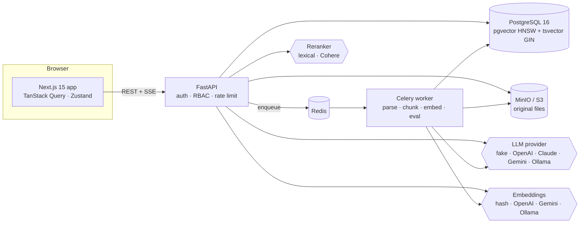
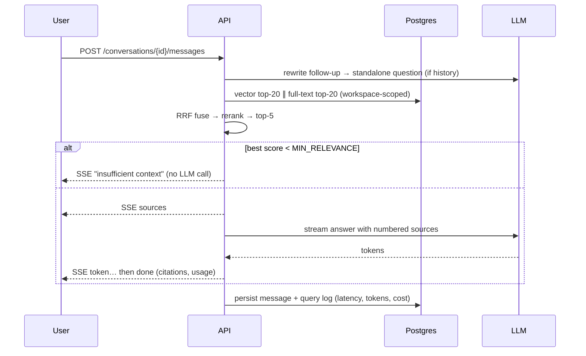
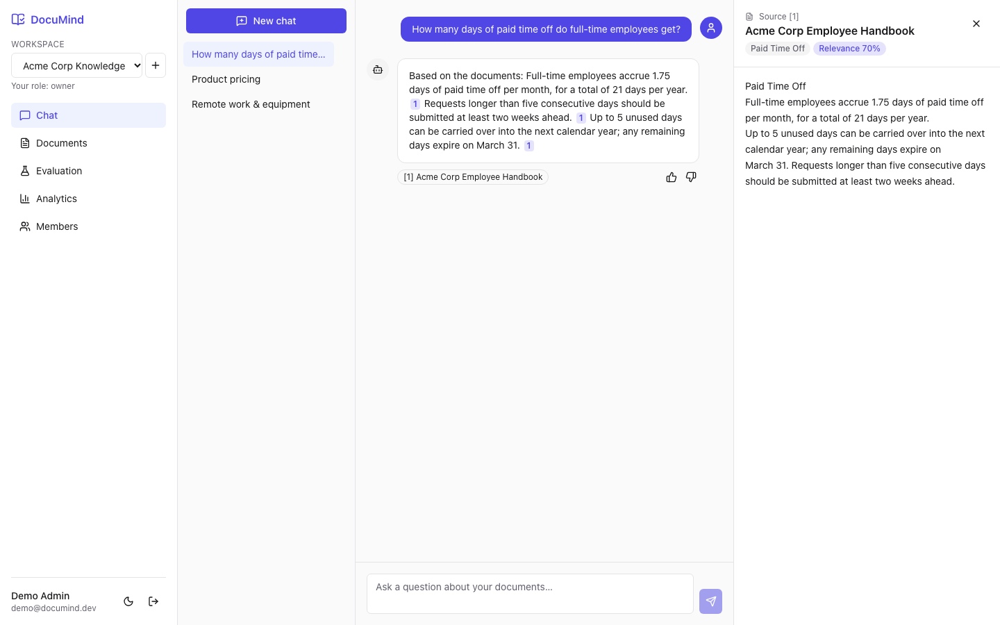
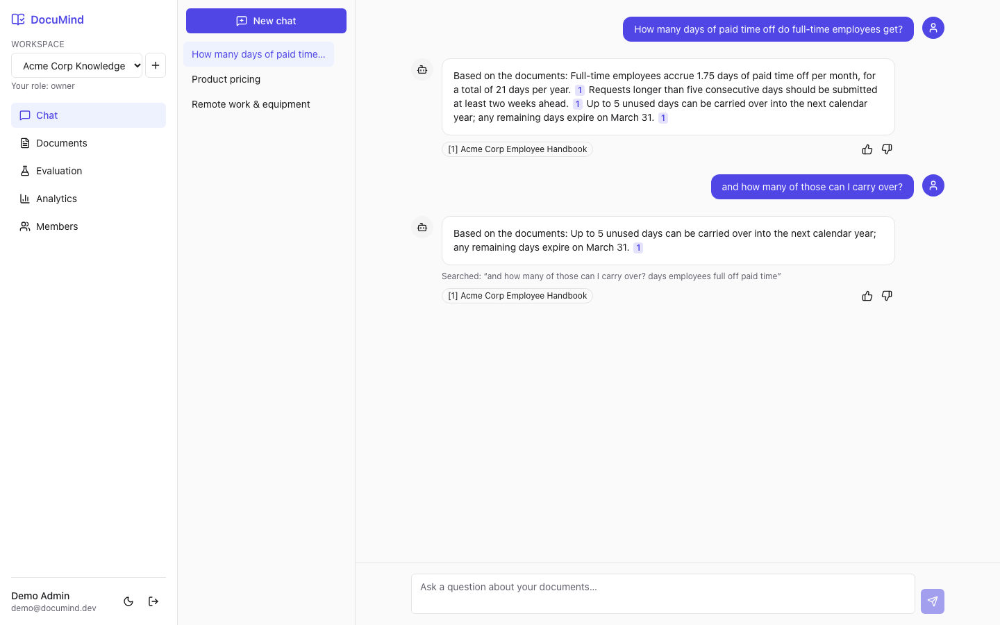
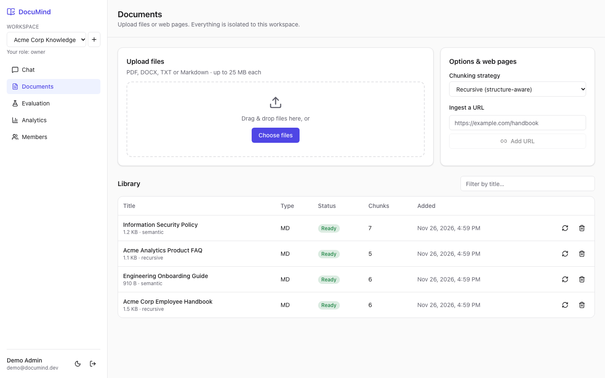
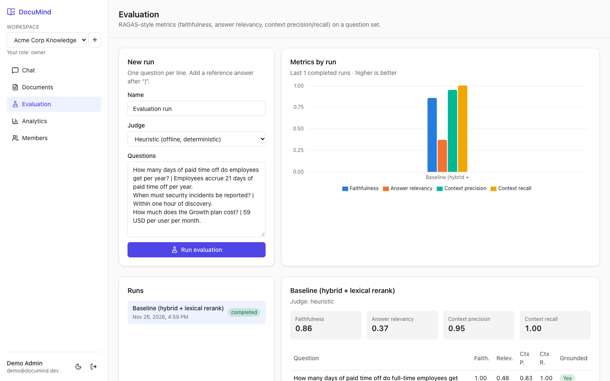
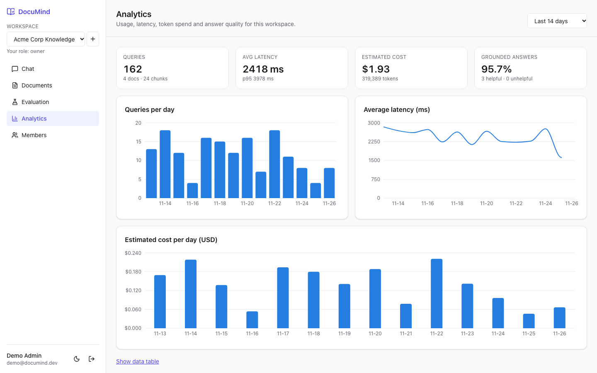
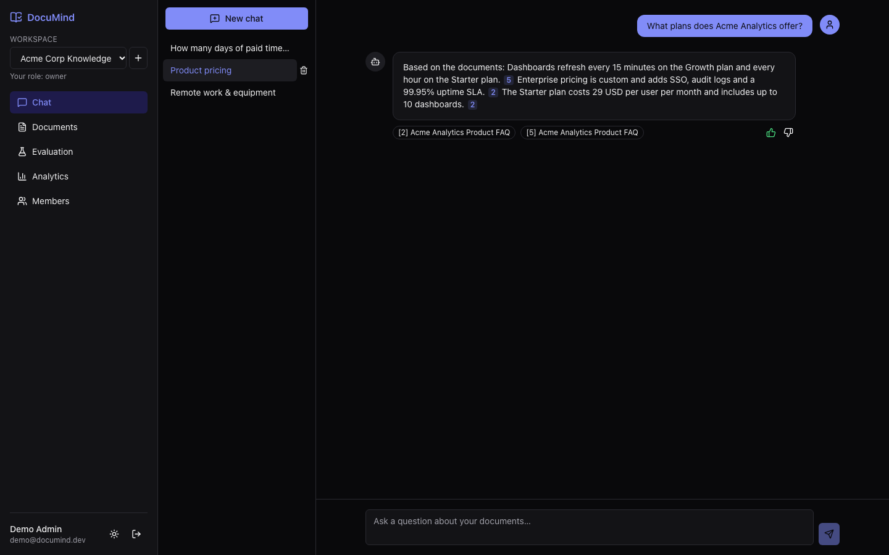

# DocuMind — Enterprise RAG Knowledge Assistant

Teams upload documents and chat with them. Every answer cites the exact page and chunk, and the
assistant declines to answer when the documents don't cover the question.

> Runs fully offline out of the box (deterministic extractive LLM + hashing embeddings), so you can
> try every feature with zero API keys. Switch to OpenAI, Anthropic Claude, Google Gemini or a local
> Ollama model with one environment variable.

## Features

- **Multi-format ingestion**: PDF, DOCX, TXT, Markdown and web URLs. Files are parsed asynchronously
  in Celery workers and stored in MinIO/S3, with live progress in the UI (queued → parsing → chunking → embedding → ready).
- **Configurable chunking**: recursive (structure-aware, LangChain splitter) or semantic
  (embedding similarity drops between sentences); page, section and title metadata are kept, and
  each chunk gets a contextual header.
- **Hybrid search**: pgvector HNSW cosine search plus Postgres full-text search, fused with
  **Reciprocal Rank Fusion**, then **reranked** (local lexical cross-scorer, Cohere Rerank, or none).
- **Streaming chat** over Server-Sent Events, token by token, with **inline citations** that open
  the exact source chunk in a preview panel.
- **Multi-turn memory** with **query rewriting**, so follow-ups like "and what about security?" are retrievable.
- **Guardrails**: below a relevance threshold the assistant declines instead of hallucinating,
  and the LLM is never called.
- **Workspaces with RBAC** (owner / admin / member): retrieval is strictly scoped to the workspace.
- **Evaluation dashboard**: RAGAS-style faithfulness, answer relevancy, context precision and
  context recall on a question set, with a heuristic or LLM-as-judge scorer and charts across runs.
- **Admin analytics**: queries per day, average and p95 latency, token usage, estimated cost,
  grounded-answer rate and feedback.
- **Feedback** (thumbs up/down) stored per message for later evaluation.
- **Production plumbing**: JWT + rotating refresh tokens with reuse detection, rate limiting
  (Redis), structured JSON logs with request IDs, a uniform error format, health/readiness probes,
  OpenAPI docs and an SSRF-guarded URL fetcher.

## Architecture



**Answer pipeline**



## Tech stack

| Layer | Technology |
|-------|------------|
| Frontend | Next.js 15 (App Router), React 19, TypeScript, Tailwind CSS v4, shadcn-style UI primitives, TanStack Query, Zustand, react-markdown, Recharts, next-themes |
| Backend | Python 3.12, FastAPI, Pydantic v2, SQLAlchemy 2.0 (async), Alembic, Celery, structlog |
| AI / RAG | LangChain text splitters, pgvector, Postgres FTS, RRF, Cohere Rerank (optional), RAGAS-style metrics, Anthropic / OpenAI / Gemini / Ollama providers |
| Data | PostgreSQL 16 + pgvector, Redis 7, MinIO (S3 API) |
| Auth | JWT access tokens + hashed, rotating refresh tokens; workspace roles |
| Testing | pytest + pytest-asyncio + coverage, Vitest + Testing Library, Playwright |
| DevOps | Docker multi-stage images, docker compose, GitHub Actions |

## Screenshots

All screenshots are from the seeded demo workspace running in the offline mode (no API keys).
Regenerate them with `cd frontend && node scripts/screenshots.mjs` against a running stack.

**Cited answers.** Each claim links to its source chunk, and the source preview shows the exact passage.



**Follow-up questions.** "How many of those can I carry over?" is rewritten into a standalone search query before retrieval.



**Document library.** Upload files or URLs, choose a chunking strategy, and watch ingestion progress.



**Evaluation.** RAGAS-style faithfulness, answer relevancy, context precision and recall per run.



**Analytics.** Query volume, latency, token cost and the grounded-answer rate per workspace.



**Dark mode.**



## Local setup

### Option A: everything in Docker (recommended)

```bash
cp .env.example .env          # optional; the defaults work offline
docker compose up -d --build  # postgres, redis, minio, api, worker, frontend + one-off seed
```

- App: http://localhost:3000 (demo login **demo@documind.dev / demo-password-123**)
- API docs (Swagger): http://localhost:8000/docs (ReDoc at `/redoc`)
- MinIO console: http://localhost:9011

The `seed` service loads a demo workspace: four company documents, two conversations, 14 days of
analytics history and a baseline evaluation run.

### Option B: run services locally

```bash
docker compose up -d postgres redis minio
cd backend && uv sync -p 3.12
uv run alembic upgrade head && uv run python -m app.seed
uv run uvicorn app.main:app --reload                       # API on :8000
uv run celery -A app.worker.celery_app worker -l INFO      # worker
cd ../frontend && npm ci && npm run dev                     # UI on :3000
```

Set `INGESTION_MODE=inline` to process uploads in the API process without Redis/Celery.

### Tests

```bash
# backend: needs Postgres+pgvector; default TEST_DATABASE_URL points at the compose DB (documind_test)
docker compose exec postgres createdb -U documind documind_test
cd backend && uv run ruff check . && uv run mypy app && uv run pytest --cov
# frontend
cd frontend && npm run lint && npm run typecheck && npm test && npm run build
# end-to-end (stack must be running)
cd frontend && npx playwright install chromium && npm run e2e
```

## Environment variables

| Variable | Default | Description |
|----------|---------|-------------|
| `LLM_PROVIDER` | `fake` | `fake` · `openai` · `anthropic` · `gemini` · `ollama` |
| `LLM_MODEL` | provider default | e.g. `claude-opus-5-5`, `gpt-4o-mini`, `gemini-2.0-flash`, `llama3.1` |
| `ANTHROPIC_API_KEY` / `OPENAI_API_KEY` / `GEMINI_API_KEY` | — | Provider credentials |
| `OLLAMA_BASE_URL` | `http://localhost:11434` | Local Ollama server |
| `EMBEDDING_PROVIDER` | `hash` | `hash` · `openai` · `gemini` · `ollama` |
| `EMBEDDING_DIM` | `768` | pgvector dimension (fixed at migration time) |
| `RERANKER` | `lexical` | `lexical` · `cohere` · `none` (`COHERE_API_KEY` for Cohere) |
| `MIN_RELEVANCE` | `0.15` | Guardrail threshold on the best reranked chunk |
| `CHUNK_STRATEGY` / `CHUNK_SIZE` / `CHUNK_OVERLAP` | `recursive` / `900` / `150` | Chunking defaults |
| `RETRIEVAL_CANDIDATES` / `RETRIEVAL_TOP_K` / `RRF_K` | `20` / `5` / `60` | Retrieval tuning |
| `DATABASE_URL` | `postgresql+asyncpg://…:5442/documind` | Async SQLAlchemy URL |
| `REDIS_URL` | `redis://localhost:6389/0` | Celery broker + rate-limit store |
| `INGESTION_MODE` | `celery` | `celery` or `inline` |
| `STORAGE_BACKEND` | `s3` | `s3` (MinIO/S3) or `local` |
| `S3_ENDPOINT_URL` / `S3_ACCESS_KEY` / `S3_SECRET_KEY` / `S3_BUCKET` | MinIO defaults | Object storage |
| `JWT_SECRET` | dev value | **Must be changed in production** |
| `ACCESS_TOKEN_MINUTES` / `REFRESH_TOKEN_DAYS` | `15` / `14` | Token lifetimes |
| `RATE_LIMIT_REQUESTS` / `RATE_LIMIT_AUTH_REQUESTS` / `RATE_LIMIT_WINDOW_SECONDS` | `120` / `10` / `60` | Rate limits |
| `CORS_ORIGINS` | `http://localhost:3000` | Comma-separated or JSON list |
| `NEXT_PUBLIC_API_URL` | `http://localhost:8000` | API URL used by the browser (build-time) |

## API

Interactive OpenAPI docs are served at `/docs`. Main endpoints:

| Method & path | Purpose |
|---------------|---------|
| `POST /api/auth/register · login · refresh · logout`, `GET /api/auth/me` | Auth |
| `GET/POST /api/workspaces`, `…/{id}/members` | Workspaces & RBAC |
| `POST /api/workspaces/{id}/documents` (multipart) · `…/documents/url` | Ingest |
| `GET …/documents`, `…/documents/{doc}/chunks`, `…/chunks/{chunk}` | Library & source preview |
| `POST …/search` | Raw hybrid search (debugging retrieval) |
| `POST …/conversations/{c}/messages` | **SSE** answer stream: `rewrite`, `sources`, `token`, `done`, `error` |
| `PUT …/messages/{m}/feedback` | Thumbs up/down |
| `POST/GET …/evals` | Evaluation runs |
| `GET …/analytics?days=30` | Admin analytics |
| `GET /health`, `GET /health/ready` | Liveness / readiness |

## Deployment

**Frontend → Vercel**: import the repo, set the root directory to `frontend`, and set
`NEXT_PUBLIC_API_URL=https://<your-api-host>`.

**Backend → Render or Railway**
1. Create a PostgreSQL database with the `vector` extension (Render/Railway Postgres, Neon or
   Supabase all support pgvector) and a Redis instance.
2. Create a web service from `backend/Dockerfile` (it runs `alembic upgrade head` on start).
3. Create a background worker from the same image with the command
   `celery -A app.worker.celery_app worker --concurrency=2`.
4. Use S3, Cloudflare R2 or any S3-compatible bucket: set `S3_ENDPOINT_URL` (blank for AWS),
   `S3_ACCESS_KEY`, `S3_SECRET_KEY` and `S3_BUCKET`.
5. Set `JWT_SECRET`, `CORS_ORIGINS=https://<your-vercel-domain>`, `LOG_JSON=true`, plus your
   `LLM_PROVIDER` / `EMBEDDING_PROVIDER` keys. Run `python -m app.seed` once if you want demo data.

## What I learned / key engineering decisions

The full log with trade-offs is in [`docs/DECISIONS.md`](docs/DECISIONS.md). Highlights:

- **Hybrid > pure vector.** Dense retrieval missed exact tokens (prices, IDs). Fusing with
  full-text via RRF needs no score calibration and fixed those misses.
- **Normalise reranker scores to [0, 1]**, so one guardrail threshold works for every reranker, and
  refuse *before* calling the LLM. Out-of-scope questions cost nothing and can't hallucinate.
- **A test found a real retrieval bug.** The follow-up "and what about security?" couldn't reach
  the *Security* section, because the chunk body never contains the word "security". Adding
  **contextual chunk headers** fixed it for both embeddings and FTS.
- **Offline-first providers** (extractive fake LLM, hashing embedder) make the entire system
  deterministic in CI and demoable without keys, behind the same Protocol the real providers use.
- **Security details that matter in multi-tenant RAG**: every retrieval query filters by
  `workspace_id`; non-members get 404s; refresh-token families are revoked on reuse; the URL
  ingester blocks private and metadata IPs, including after redirects.
